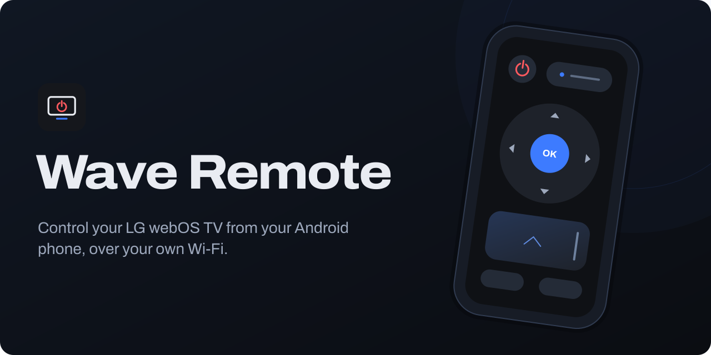
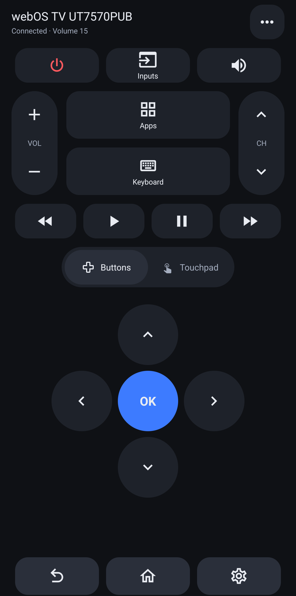
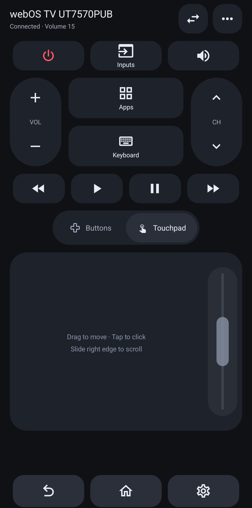

<p align="center">
  
</p>

<p align="center">
  <a href="https://github.com/VesselWave/wave-remote/releases/latest"></a>
  <a href="LICENSE"></a>
</p>

Control your LG webOS TV from your Android phone, over your own Wi-Fi. It talks to the TV directly: no account, no cloud, no ads, no analytics.

**[Download the APK](https://remote.vwave.me)** · [Changelog](CHANGELOG.md)

<p align="center">
  
  &nbsp;&nbsp;
  
</p>

- D-pad with hold-to-repeat, or a touchpad with a scroll strip and two-finger scrolling
- Volume, mute, channels, playback, inputs, apps and keyboard input
- Your phone's volume buttons control the TV
- Turn the TV on (Wake-on-LAN or Bluetooth) and off
- Finds TVs on your network, or connects by IP address
- Remembers several TVs and switches between them

## Setup

1. Install the APK on an Android 7+ phone (arm64).
2. Connect to the same network as the TV. Guest Wi-Fi and client isolation can get in the way.
3. Open the app, pick your TV and accept the prompt on the TV. It may say "LG Mobile" ([why](NOTICE.md)).

To turn the TV on from the app, connect once while it's on and enable **Mobile TV On** (or **Turn on via Wi-Fi**) in the TV's settings. Bluetooth wake also needs the Nearby devices permission on Android 12+.

Tested with an LG 65UT7570PUB (webOS 24) and a Pixel 7. Other webOS TVs may work. Stuck? See [troubleshooting](docs/TROUBLESHOOTING.md).

## Building

Needs Bun, JDK 17+, Python 3 and the Android SDK (platform 36, build-tools 36.0.0).

```sh
bun install
bun test && ./test.sh   # app tests, then protocol tests against a mock TV
./build.sh debug        # dist/wave-remote-v<version>-debug.apk
```

The UI is Expo and React Native; the TV protocol is a Java engine in `src/me/vwave/remote`, wrapped by the Expo module in `modules/wave-remote`. Expo Go can't load that module, so install the built APK. More in [CONTRIBUTING.md](CONTRIBUTING.md) and [docs/RELEASING.md](docs/RELEASING.md).

---

MIT licensed. Independent project, not affiliated with LG. Pairing keys stay on your phone; see [SECURITY.md](SECURITY.md) for how the connection is secured.
